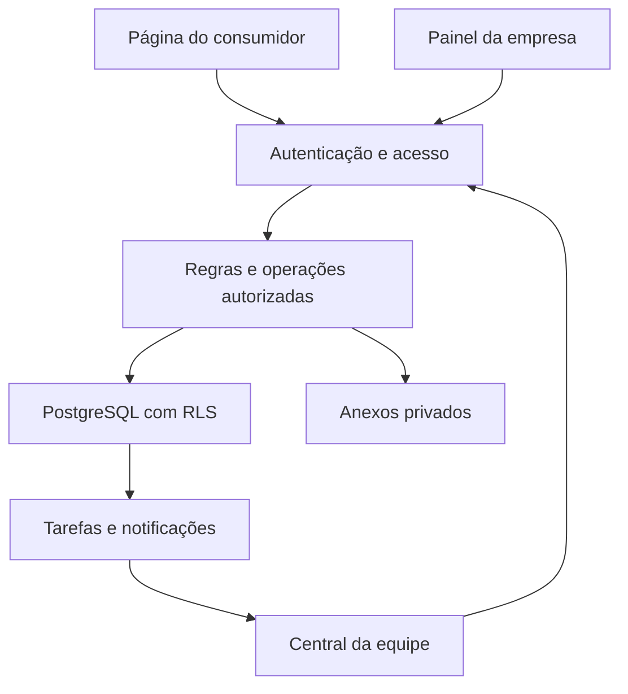

> Revisão atual de autenticação: `access/architecture.md`, migration 026. Código empresarial + username + senha, Supabase Auth e recuperação administrativa. As decisões históricas abaixo permanecem para os demais módulos.

# Plataforma de autoatendimento e atendimento humano compartilhado

Fase 1 — análise e proposta de arquitetura • 15/09/2026

**Regra permanente posterior, determinada por Marcelo:** desenvolver, organizar, testar e entregar somente o projeto com seus arquivos. Publicação, deploy em qualquer serviço, produção e lançamento são responsabilidade exclusiva do usuário. Não contratar/ativar serviços pagos, configurar domínio em produção, disponibilizar para clientes ou usar dados reais. Instruções de deploy são preparação documental, sem autorização para executá-las. Homologação externa exige explicar as configurações e preparar instruções para ações dependentes do usuário. Cada fase continua exigindo aprovação expressa. Ver `docs/project-boundaries.md` no pacote do projeto.

Base: especificação enviada por Marcelo, com 50 seções. Este documento complementa essa especificação. É uma proposta para revisão; não representa software implementado, infraestrutura contratada ou segurança já testada.

**Decisão recomendada:** construir um único sistema multiempresa, com página pública por prestador, painel empresarial e central compartilhada. Preservar Supabase como preferência de backend. Começar com a MS Auto Details como piloto e uma segunda empresa fictícia para verificar isolamento.

O produto funciona sem IA e sem API do WhatsApp. O trabalho humano é parte central da operação e precisa ser medido desde os primeiros atendimentos.

## 1. Ajustes necessários na especificação

| Ponto em aberto | Decisão proposta para o MVP |
|---|---|
| Nome e WhatsApp identificam o cliente, mas não autenticam acesso | Criar sessão técnica anônima para a primeira solicitação; o telefone informado não libera histórico nem confirma identidade. |
| Como voltar em outro aparelho sem senha ou e-mail obrigatório | Link de acesso restrito à solicitação, secreto, revogável e com validade. Recuperação exige verificação de contato; nunca basta digitar o telefone. |
| `conversations` e `tickets` podem representar a mesma coisa | Usar `tickets` como unidade de atendimento e `ticket_messages` para mensagens. Não criar conversa paralela no MVP. |
| “Convertido” aparece no atendimento e no funil | Separar estado operacional do ticket, resultado comercial da oportunidade e execução do serviço. |
| Agendar pode ser confundido com faturar | Aprovação/agendamento são contratação; realização é execução; nenhum desses eventos confirma recebimento financeiro. |
| Limite do plano não define quando consumir uma unidade | Consumir um atendimento na primeira ação humana substantiva, uma vez por ticket. Visualizar, assumir ou transferir não consome. |
| Orçamento com preço “a partir de” | Mostrar estimativa até avaliação. Apenas uma versão final enviada pode ser aprovada pelo consumidor. |
| Agenda para segmentos muito diferentes | Uma agenda por empresa, capacidade simultânea de um serviço, no piloto. Modelar recurso de agenda para futura expansão. |
| Horário do estabelecimento versus horário da equipe | Manter configurações separadas e mostrar ao cliente o horário relevante. |
| “Atendente principal” versus permissão de acesso | Exigir vínculo ativo com a empresa; ser reserva também exige vínculo explícito. |
| Abandono sem identificação | Gerar recuperação apenas se houver solicitação persistida, contato utilizável e permissão pertinente. Visita anônima não vira lead contatável. |
| Autonomia pode conter opções contraditórias | “Nunca alterar preço” bloqueia desconto e negociação. Validar contradições no salvamento. |
| Histórico versus exclusão de dados | Prever procedimento de exportação, exclusão ou anonimização com revisão de retenção; não prometer histórico pessoal eterno. |

Essas decisões são propostas de produto. Devem ser incorporadas à especificação aprovada antes das respectivas fases de implementação.

## 2. Recorte do MVP

O MVP deve atender prestadores com serviços de preço fixo ou orçamento manual e uma agenda simples. Não tentar reproduzir, na primeira versão, as operações completas de oficina, salão e fotografia ao mesmo tempo.

Entram: cadastro empresarial, catálogo, adicionais, manual, FAQ, autonomia, orçamento versionado, agenda, atendimento assíncrono, fila compartilhada, encaminhamento excepcional, retorno programado, histórico, funil simples e medição de esforço humano.

Também entram as bases de segurança, notificações internas, anexos de imagem, recuperação determinística e controle manual de plano/consumo. E-mail transacional entra quando houver provedor configurado; ausência de e-mail não deve impedir o fluxo principal no navegador.

Ficam para depois: cobrança automática, múltiplas unidades, agendas complexas com vários profissionais, distribuição automática, domínios personalizados por empresa, campanhas, aplicativo nativo e integrações adicionais. IA, WhatsApp API, ERP, emissão fiscal e estoque continuam fora do MVP.

Imagens de referência podem ser anexadas já no piloto. PDF e outros formatos entram depois de uma política específica de validação. Informar essa limitação na interface.

## 3. Arquitetura e hospedagem propostas

| Camada | Escolha proposta | Responsabilidade |
|---|---|---|
| Interface | React + TypeScript + Vite | Página pública, painel empresarial e central da equipe. |
| Navegação | React Router | Rotas públicas e autenticadas. |
| Backend | Supabase | Auth, PostgreSQL, Storage e funções para operações privilegiadas. |
| Transações | Funções PostgreSQL controladas | Reservas, aprovações, alterações de estado e consumo idempotente. |
| Segurança de dados | RLS, privilégios e validação de domínio | Verificar quem pode ler e alterar cada registro. |
| Mensagens | Persistência no banco; Realtime seletivo | Atualização de tickets com recarregamento seguro após reconexão. |
| Retornos | Tarefas persistidas consultadas por vencimento | A fila funciona sem depender de um temporizador no navegador. |
| E-mail | Provedor transacional configurável | Apenas notificações necessárias, com envio pelo backend. |
| Testes | Integração com PostgreSQL e testes de navegador | Isolamento, concorrência, permissões e jornadas principais. |

**Opção de hospedagem documentada para decisão e execução futura de Marcelo: frontend Vite na Vercel e backend no Supabase.** A documentação da Vercel oferece suporte a projetos Vite e URLs de prévia [1]. A escolha aqui é arquitetural; não há implantação nem contratação nesta fase. Planos, condições de uso comercial e custos precisam ser confirmados antes da ativação.

Essa separação permite manter as regras e os dados fora do frontend. Não é necessário manter um servidor Node dedicado no MVP. Rewrites devem encaminhar rotas da aplicação para o frontend sem transformar erros de API em páginas HTML.

Sites também foi considerado. Antes de utilizá-lo para esta aplicação pública com autenticação externa, seria necessário confirmar o caminho de autenticação suportado pela plataforma. Não substituir Supabase Auth por uma exigência de conta ChatGPT para o consumidor sem revisar o produto.

GitHub Pages não é descartado porque a aplicação tem banco: um frontend pode consumir backend externo. A preferência por outro host decorre da operação de rotas, ambientes e publicação deste produto. O backend continuará responsável pela segurança independentemente do host.

Ambientes de desenvolvimento e produção devem usar dados e segredos separados. Código e migrações ficam versionados; nenhum segredo administrativo entra no bundle do navegador.

## 4. Autenticação, acesso e isolamento

**Equipe e empresas:** contas individuais com Supabase Auth, recuperação de senha e convites. Marcelo pode acumular papel administrativo e de atendente; Ranna recebe papel de atendente e vínculos com as empresas atendidas. Nomes de pessoas não entram como regras no código. Provisionamento do primeiro administrador ocorre em procedimento restrito; usuários não podem promover a si mesmos.

**Consumidor:** consulta catálogo sem autenticação. Ao enviar solicitação, recebe sessão técnica anônima. Supabase oferece esse tipo de sessão, mas ela precisa de políticas específicas e de proteção contra abuso [2]. A aplicação liga a solicitação ao identificador dessa sessão, sem exigir senha.

O consumidor vê somente registros ligados à sua sessão ou a uma autorização específica válida. Digitar o mesmo telefone de outra pessoa nunca permite consultar suas conversas. Não mesclar cadastros automaticamente por coincidência de telefone.

O link de acompanhamento funciona como credencial: segredo aleatório de alta entropia, hash no banco, escopo limitado, expiração, revogação e troca por sessão restrita. Evitar segredo em logs e encaminhamento por referenciador; remover da URL após a troca. Compartilhar esse link concede acesso ao seu escopo, então ele não pode liberar todo o cadastro do cliente. Ações de cancelamento/aprovação exigem confirmação explícita, nunca simples abertura do link.

Se perder a sessão e o link, o consumidor pode recuperar por e-mail verificado, quando cadastrado, ou por verificação manual do contato pela equipe. Uma solicitação nova não desbloqueia pedidos anteriores. Perder a sessão anônima sem mecanismo de recuperação é uma limitação conhecida [2].

| Perfil | Alcance de leitura | Ações permitidas |
|---|---|---|
| Visitante | Conteúdo empresarial publicado | Consultar e iniciar solicitação com controle de abuso. |
| Consumidor identificado pela sessão | Seus registros autorizados | Mensagens, confirmação de proposta final e gestão de reserva conforme regras. |
| Administrador da empresa | Sua empresa | Configurar operação, serviços, colaboradores, manual e autonomia. |
| Colaborador da empresa | Sua empresa e permissões delegadas | Somente ações explicitamente concedidas. |
| Atendente | Empresas vinculadas e ativas | Atender dentro da autonomia de cada empresa. |
| Administrador da plataforma | Administração global | Gerir contas e planos; acesso a conteúdo operacional explícito e auditado. |

RLS deve ser ativada em todas as tabelas expostas com dados privados. Ela complementa a autorização do backend; não deve depender de esconder botões [3].

Regras obrigatórias do modelo proposto:

- `organization_id` obrigatório em entidades empresariais, com índices para consultas da empresa.
- Chaves estrangeiras compostas, como `(organization_id, customer_id)`, impedem referenciar cliente de outra empresa, mesmo em uma escrita autorizada.
- Policies de leitura e escrita verificam sessão, vínculo, estado ativo e escopo. Papéis vindos de campos editáveis pelo usuário não conferem autoridade.
- Suspensão de usuário ou vínculo bloqueia a próxima operação, mesmo com token ainda válido. Encerrar canais ativos e testar se deixam de receber eventos.
- Conteúdo público sai de projeção controlada que exclui manual interno, telefone particular, clientes e observações. Se houver view, suas propriedades de segurança precisam ser explicitamente configuradas e testadas.
- Uploads usam bucket privado, autorização por empresa/solicitação e URLs temporárias. A pasta do arquivo, sozinha, não garante permissão.
- Operações administrativas com chave privilegiada passam por validação explícita e auditoria. Funções privilegiadas usam escopo restrito, `search_path` seguro e execução limitada.
- Autonomia também é aplicada no banco/backend: remover permissão ou baixar desconto máximo tem efeito sem depender de atualizar a tela.

## 5. Modelo de dados

Convenções: UUID como identidade; valores em centavos inteiros; datas de eventos em UTC; fuso empresarial explícito, inicialmente `America/Recife` para o piloto; números públicos separados do identificador interno. Não reiniciar sequências para esconder testes. Usar dados de teste em ambiente separado.

| Tabelas | Campos e relações essenciais |
|---|---|
| `auth.users`, `profiles`, `platform_roles` | Identidade de login; perfil ativo; papéis globais controlados administrativamente. Não duplicar senhas. |
| `organizations`, `organization_members` | Empresa, slug único, situação, fuso; membro, papel e estado. Único por empresa/usuário. |
| `attendant_organizations` | Atendente, empresa, função principal/reserva e estado. Unique por empresa/atendente. |
| `services`, `service_addons` | Empresa, nome, modalidade de preço, preço mínimo/fixo, duração, opções e estado. |
| `service_intake_fields` | Perguntas de orçamento por serviço, tipo simples e obrigatoriedade. Sem construtor genérico complexo. |
| `manual_versions`, `manual_sections`, `faqs`, `quick_replies` | Versões publicadas do manual, tópicos e respostas aprovadas. FAQ pública separada de informações internas. |
| `attendant_permissions`, `business_rules` | Autonomia por empresa, desconto máximo, políticas e critérios determinísticos. |
| `schedule_resources`, `business_hours`, `blocked_times` | Recurso de agenda, expediente e indisponibilidades. Um recurso ativo por empresa no piloto. |
| `customers`, `customer_access`, `customer_consents` | Cadastro por empresa; vínculo de acesso verificado/sessão; finalidade, versão, data e revogação das autorizações. |
| `request_access_tokens` | Hash do segredo, solicitação autorizada, validade, revogação e limite de uso quando aplicável. |
| `opportunities` | Cliente, serviço pretendido, etapa comercial, motivo de perda e classificação por regras. |
| `quotes`, `quote_versions`, `quote_items` | Solicitação comercial, versões imutáveis enviadas e itens com nome/preço/duração congelados. |
| `appointments` | Cliente, recurso, início/fim, estado, oportunidade e versão de orçamento aprovada quando houver. |
| `tickets`, `ticket_messages` | Cliente, empresa, responsável, estado, prioridade; mensagens públicas ou notas internas com acesso distinto. |
| `ticket_events` | Alteração de responsável, estado, primeira ação humana, reabertura, resultado e encaminhamento. |
| `tasks` | Ticket/oportunidade, tipo, responsável, vencimento, estado e resultado. Retorno é um tipo de tarefa. |
| `work_sessions` | Atendente, empresa, ticket, início/fim e duração efetivamente trabalhada. |
| `customer_events` | Linha do tempo com referências aos fatos originais e visibilidade; não duplicar corpos de mensagens. |
| `attachments` | Empresa, proprietário, mensagem ou solicitação vinculada, caminho privado, tamanho, tipo e estado de validação. |
| `notifications`, `notification_deliveries` | Notificação interna e, quando habilitado, tentativas de entrega externa sem duplicação. |
| `plans`, `subscriptions`, `usage_records` | Configuração versionada do plano, vigência, cota e consumo/ajuste por ticket. Cobrança automática posterior. |
| `audit_logs` | Ações sensíveis com ator, empresa, operação, alvo e instante; evitar copiar dados pessoais desnecessários. |

Relações centrais: empresa possui clientes; cliente possui oportunidades; oportunidade pode gerar orçamentos, tickets e agendamentos; ticket possui mensagens, eventos, tarefas e sessões de trabalho. `followups` e `conversations` não viram tabelas adicionais no MVP.

Constraints propostas:

- Slug normalizado único, com rotas internas reservadas.
- Preço não negativo; desconto entre zero e o máximo autorizado; cálculos refeitos no servidor.
- Versão enviada de orçamento imutável; alteração gera nova versão, e aprovação usa o identificador da versão correta.
- Uma aprovação repetida não gera segunda reserva, segundo consumo ou evento duplicado.
- `ends_at > starts_at`; duração inclui intervalos necessários.
- Reserva usa intervalo semiaberto `[início, fim)`, permitindo começar exatamente quando outra termina.
- Restrição de exclusão por empresa/recurso impede sobreposição de reservas ativas no banco. PostgreSQL oferece esse mecanismo para intervalos [4].
- Bloqueios e reservas usam o mesmo bloqueio transacional por recurso; assim, criação de indisponibilidade simultânea não atravessa uma reserva em andamento.
- Chave única de consumo por ticket e tipo de evento inicial. Estornos são lançamentos vinculados ao original, sem reescrever o histórico.
- Uma sessão de trabalho aberta por atendente; transferência encerra ou solicita fechamento da sessão anterior.
- Relações de anexos têm exclusividade de destino e validação de empresa; impedir vínculo genérico que escape de constraints.

## 6. Regras dos fluxos principais

**Orçamento:** selecionar serviço, responder perguntas, informar dados mínimos e enviar. Preço fixo permite cálculo exato; “a partir de” gera estimativa claramente identificada; sob consulta exige avaliação. A equipe prepara e envia uma versão final. O consumidor aprova essa versão. Mudanças de preço exigem nova versão e nova aprovação. Aprovação não reserva horário automaticamente.

**Agendamento:** consultar disponibilidade, escolher horário e confirmar. O servidor recalcula duração e valida regras dentro de transação. Se outro cliente ocupar o horário, retornar conflito com opções atualizadas e preservar os dados preenchidos. Cancelar libera o intervalo; remarcar é atômico, preservando a reserva antiga se a nova falhar. Serviços sem duração previsível exigem avaliação antes do agendamento direto.

**Atendimento:** FAQ, pedido de ajuda, entrada na fila, assumir, consultar manual e responder. Assumir precisa ser operação atômica para dois atendentes não tomarem o mesmo ticket. Mensagens são gravadas antes da atualização visual; tentativas repetidas usam identificador idempotente. Falha de conexão mostra pendência e permite tentar novamente.

**Exceção:** a atendente escolhe motivo, registra pergunta objetiva e encaminha à empresa. O cliente recebe mensagem adequada; notas internas ficam ocultas. A resposta empresarial volta ao ticket. Uma resposta pontual só vira regra de manual após publicação aprovada pela empresa.

**WhatsApp:** abrir link com número e texto revisável. Abrir o aplicativo não significa enviar mensagem. A atendente registra separadamente tentativa, envio confirmado por ela e resultado. O conteúdo externo não é sincronizado. Manter o número de atendimento que será utilizado na configuração operacional, para não pressupor acesso ao número da empresa.

**Retorno:** salvar tarefa com data/hora e motivo. Uma consulta de tarefas vencidas alimenta a fila mesmo após reinício do navegador. Rotina de recuperação procura apenas registros elegíveis e cria no máximo uma tarefa ativa por evento/regra. Aprovação, cancelamento, resposta do cliente ou pedido para não receber contato encerra as tarefas incompatíveis.

**Recuperação aprovada:** prazo configurável por empresa e, quando aplicável, por serviço ou regra de recuperação. Oferecer opções de 2 horas, 6 horas, 24 horas, 48 horas e duração personalizada positiva. Precedência: regra específica, serviço, empresa e padrão do sistema. Distinguir duração em horas corridas de janela permitida de contato; ajustar o vencimento para a próxima janela quando necessário. Não fixar dois dias úteis no código. O limite de tentativas também é configurável; padrão proposto de duas tentativas no MVP, com encerramento imediato ao recusar ou revogar a autorização. Padrões são sugestões editáveis, não regras fixas. Esta configuração será implementada na fase comercial, não na Fundação.

**Suspensão:** impedir novas operações e acessos conforme estado de conta. Suspensão de cobrança não deve apagar histórico. Diferenciar usuário suspenso, empresa suspensa e plano com cota esgotada.

## 7. Estados e métricas sem ambiguidade

| Entidade | Estados principais |
|---|---|
| Ticket | Novo, em atendimento, aguardando cliente, aguardando empresa, retorno programado, resolvido, cancelado. |
| Resultado do ticket | Orientado, contratação realizada, perdido ou sem resultado comercial; não substitui o estado operacional. |
| Oportunidade | Novo, interessado, orçamento, negociação, agendado, convertido, perdido. |
| Orçamento | Solicitado, em análise, aguardando informação, pronto, enviado, aprovado, recusado, expirado, cancelado. Visualização registrada como evento. |
| Agendamento | Confirmado, em execução, realizado, cancelado, não compareceu. Remarcação registrada em evento. |
| Tarefa | Pendente, em execução, concluída, cancelada. Atraso calculado pelo vencimento. |

Cada transição tem ator permitido, pré-condições e evento auditável. Uma enumeração de estados, isoladamente, não garante fluxo válido.

Contar uma unidade de atendimento na primeira resposta pública humana ou ação substantiva de orçamento, agenda ou contato externo registrada. Ação administrativa, leitura e transferência não contam. Reabertura do mesmo assunto continua o mesmo ticket; assunto diferente cria outro. Correções administrativas ficam registradas.

Cota proposta: aviso próximo do limite, sem cobrança automática por excedente; novos atendimentos aguardam decisão administrativa ou são direcionados à própria empresa. Tickets já iniciados continuam. Registrar excedente explicitamente se autorizado. Exibir condições ao empresário antes de ativar o plano.

O mês de consumo é o da primeira ação contabilizável no fuso contratado. Transferir, reabrir ou atravessar o mês não consome novamente. Estorno mantém referência ao período original.

Tempo até primeira resposta e duração total do ticket são diferentes de trabalho humano. Usar cronômetro com início/pausa e correção justificada; não contar o tempo aguardando cliente como trabalho. O registro manual deve indicar quando o valor é estimado.

Conversão comercial proposta: orçamento final aprovado ou agendamento direto confirmado. Serviço realizado e pagamento recebido permanecem conceitos separados. Exibir “valor contratado”, nunca “receita recebida”, quando só houver contratação registrada.

“Conversão após acompanhamento” exige contato registrado antes da conversão e dentro da janela configurada, inicialmente sete dias. Contar cada oportunidade uma vez. Essa associação temporal não demonstra causalidade. Cancelamentos devem aparecer separadamente para não inflar resultados.

## 8. Mapa de páginas e componentes

| Área | Rotas propostas | Conteúdo e componentes |
|---|---|---|
| Acesso | `/entrar`, `/recuperar-acesso`, `/aceitar-convite` | Formulário de acesso, recuperação e aceite de convite. |
| Consumidor | `/empresa/:slug` | Cabeçalho da empresa, catálogo, FAQ e pedido de ajuda. |
| Consumidor | `/empresa/:slug/orcamento` | Seletor de serviço, adicionais, perguntas, anexos e identificação. |
| Consumidor | `/empresa/:slug/agendar` | Calendário, horários, dados e confirmação. |
| Consumidor | `/acompanhar/:id` | Resumo autorizado, mensagens, orçamento e agendamento; ID sozinho não autoriza acesso. |
| Empresa | `/painel/:orgId/hoje` | Agenda de hoje, solicitações e pendências. |
| Empresa | `/painel/:orgId/configuracao` | Etapas de onboarding, publicação e checklist. |
| Empresa | `/painel/:orgId/servicos`, `/manual`, `/autonomia` dentro do mesmo prefixo | Catálogo, editor do manual e limites de atuação. |
| Empresa | Agenda, clientes, orçamentos e atendimentos sob `/painel/:orgId` | Listas, filtros e detalhes com histórico. |
| Atendente | `/central/fila`, `/central/tickets/:id` | Fila, conversa, dados da empresa, manual e ações rápidas. |
| Atendente | `/central/retornos` | Tarefas por vencimento, prioridade e responsável. |
| Administração | `/admin/empresas`, `/admin/equipe`, `/admin/planos`, `/admin/operacao` | Contas, vínculos, configurações, consumo e capacidade. |

Usar `/empresa/:slug` inicialmente evita colisões com rotas internas. Rotas curtas podem ser adicionadas depois.

Na central em desktop: fila à esquerda, conversa no centro e manual/ações à direita. Em celular: alternância entre essas áreas sem perder rascunho. A empresa atual deve aparecer claramente ao lado da conversa e das ações de orçamento/contato.

Componentes compartilhados: identificação empresarial, seletor de serviço, resumo do orçamento, calendário, cartão de tarefa, histórico, anexos, estados de carregamento, confirmação de ação e aviso de erro recuperável. Paginar filas e históricos; não carregar todos os clientes de todas as empresas.

## 9. Segurança operacional, falhas e privacidade

O checklist de ativação humana exige serviços, política de preços, funcionamento, FAQ, autonomia e responsável por exceções. No plano apenas plataforma, esse checklist não deve bloquear indevidamente o catálogo e autoatendimento.

Falhas que precisam de resposta definida:

- Sessão expirada: preservar rascunho local sem revelar informação a outra conta; solicitar novo acesso.
- Empresa suspensa ou página retirada: informar indisponibilidade sem expor dados internos.
- Serviço desativado entre seleção e envio: pedir nova seleção; não confirmar com catálogo obsoleto.
- Orçamento alterado ou expirado: mostrar a versão válida e impedir aceite da antiga.
- Horário ocupado: apresentar alternativas; não criar confirmação falsa.
- Mensagem repetida ou clique duplo: recuperar resultado da primeira operação.
- Anexo inválido: rejeitar com motivo; aceitar inicialmente JPEG, PNG e WebP, até 5 MB e cinco imagens por solicitação, como limites propostos.
- Arquivo com extensão enganosa: validar assinatura e decodificação, limitar dimensões e remover metadados de imagem desnecessários.
- Falha de e-mail: manter notificação interna e registrar tentativa; não perder a solicitação principal.
- Permissão removida durante a tela aberta: negar a ação no servidor e atualizar a interface.

Não registrar segredos, links de acesso completos nem conteúdo sensível em logs. Notas internas e mensagens públicas devem ter autorização distinta também nas consultas e canais em tempo real.

O modelo prevê registro de finalidade, versão do aviso, autorizações aplicáveis e revogações. Exportações devem verificar identidade e abranger somente dados autorizados. Prazos de retenção e textos jurídicos precisam de definição própria antes da operação real; esta arquitetura não é certificação de conformidade legal. Fora do piloto, segmentos com dados sensíveis exigem revisão específica.

Antes de receber clientes reais, configurar cópias de segurança compatíveis com o ambiente escolhido e realizar um teste de restauração. Não presumir que a existência do banco garante recuperabilidade.

## 10. Desenvolvimento por fases e critérios de aceite

| Fase | Entrega, tabelas e telas | Verificação necessária para avançar |
|---|---|---|
| 1 — Arquitetura | Este documento: decisões, modelo, acessos, rotas e fluxos. | Revisão do recorte e das regras propostas por Marcelo. |
| 2 — Fundação | Identidades, organizações, membros, vínculos, auditoria e RLS; telas de acesso e administração mínima. | Empresa A não acessa B; atendente sem vínculo é negado; suspensão efetiva; usuário não se promove. |
| 3 — Empresa | Serviços, adicionais, perguntas, manual, FAQ e autonomia; onboarding e configuração. | Manual incompleto bloqueia ativação humana; contradições são rejeitadas; empresa só publica seu conteúdo. |
| 4 — Consumidor | Clientes, acessos, consentimentos, oportunidades, orçamentos, agenda e anexos; páginas públicas. | Troca de URL não expõe outro cliente; duas confirmações simultâneas resultam em uma reserva; preço é validado no servidor. |
| 5 — Atendimento | Tickets, mensagens, eventos, tarefas manuais e sessões de trabalho; fila e tela de atendimento. | Transferência preserva histórico; notas internas não vazam; dupla atribuição e mensagem repetida são tratadas. |
| 6 — Comercial | Regras de recuperação e tarefas automáticas simples; retornos e funil. | Tarefa vencida aparece após reconexão; rotina repetida não duplica tarefas; recusa/cancelamento encerra acompanhamento. |
| 7 — Métricas | Consultas agregadas, utilização e capacidade; painéis simples. | Contagens conciliam com eventos; tempo trabalhado exclui espera; conversão não aparece como pagamento. |
| 8 — Cobrança | Integração de pagamento após operação validada; tabelas/configuração de planos já existem antes. | Webhooks idempotentes e verificados, caso implementados; transições de assinatura testadas sem cobrar clientes reais em teste. |

Em cada fase: detalhar tabelas, páginas e componentes afetados; definir autorização e erros; implementar; executar testes pertinentes; corrigir; documentar o que passou e o que está pendente. Nesta fase 1, nenhum teste de implementação foi executado porque o sistema ainda não foi construído.

Testes obrigatórios adicionais: referenciar cliente de outra empresa na escrita; tentar usar sessão anônima como funcionário; desconto acima do limite via requisição direta; token expirado/revogado; reserva durante criação de bloqueio; falha de remarcação preservando reserva original; estorno de consumo; transferência com atendente suspenso; acesso indevido a arquivo privado; revogação em canal ativo.

## 11. Piloto e validação do negócio

Preparar dados fictícios representativos da MS Auto Details e de uma empresa B. Não copiar automaticamente cadastros reais nem conectar o banco atual da MS. Usar serviços de preço fixo e sob avaliação, horários bloqueados, cliente sem e-mail, orçamento sem resposta e reclamação fora do manual.

Executar jornada completa: cliente solicita, atendente esclarece usando manual, envia orçamento, cliente aprova, escolhe horário e empresa registra realização. Executar também cancelamento, perda e tentativa de acesso entre empresas.

Após validar o software, testar com poucas empresas reais de perfis semelhantes. Registrar o volume de solicitações, proporção resolvida sem dono, tempo ativo por empresa, retornos, conversões após contato e motivos de encaminhamento.

Para avaliar se sustenta o trabalho de Ranna e Marcelo, usar dados reais de horas e custos. Estrutura proposta de cálculo: receita das assinaturas menos infraestrutura, tributos/taxas aplicáveis e custo das horas humanas. Não definir salário viável nem preço final a partir de estimativas de volume não comprovadas.

**Ponto de revisão:** aprovar o recorte de agenda simples, acesso do consumidor, unidade de atendimento, estados comerciais e hospedagem proposta. A pausa antes da programação decorre expressamente das seções 45 e 50 do arquivo enviado. Após a revisão, a próxima entrega é a fundação multiempresa com seus testes de isolamento.

## Referências técnicas consultadas

As decisões de produto acima são propostas. As referências abaixo sustentam apenas os mecanismos técnicos indicados, sem constituir garantia de uma implementação futura.

1. Vercel — Vite on Vercel: https://vercel.com/docs/frameworks/frontend/vite — suporte à publicação e prévias de projetos Vite.
2. Supabase — Anonymous Sign-Ins: https://supabase.com/docs/guides/auth/auth-anonymous — sessões anônimas, políticas, abuso e limitações de retorno à conta.
3. Supabase — Row Level Security: https://supabase.com/docs/guides/database/postgres/row-level-security — autorização por linhas, papéis e cuidado com chaves privilegiadas.
4. PostgreSQL — Range Types: https://www.postgresql.org/docs/current/rangetypes.html — intervalos e constraints de exclusão para sobreposição.

Consulta em 15/09/2026. Versões de bibliotecas, limites de serviços, condições comerciais e integrações devem ser verificadas na fase de implementação.

## Aprovação e ajuste de escopo

Fase 1 e recorte aprovados por Marcelo. Incorporada a configuração de intervalos e limite de tentativas de follow-up conforme solicitado. Autorizada somente a Fase 2; encerrar após testes e documentação, aguardando aprovação antes da Fase 3.

## Limite permanente de entrega incorporado

O produto do trabalho do agente é o projeto portátil e seus arquivos. O usuário realizará publicação e lançamento posteriormente. Esta regra prevalece sobre sugestões anteriores de publicação automática e não altera as proteções de segurança nem autoriza a Fase 3. A homologação externa pendente continua distinta da entrega local e do lançamento.

## Autorização posterior — Fase 3 e conceitos permanentes

Marcelo aprovou a Fundação para continuidade do **DESENVOLVIMENTO** e autorizou a Fase 3 — Empresa. A homologação real continua **PENDENTE DE HOMOLOGAÇÃO EXTERNA**, sem impedir fases aprovadas tecnicamente viáveis com ambiente local, mocks e dados fictícios. Guias e ferramentas de homologação devem permanecer no projeto. **PRODUÇÃO E LANÇAMENTO** continuam exclusivos de Marcelo, sem deploy, contratação, ativação de planos pagos ou dados/clientes reais. Essa autorização substitui as pausas anteriores referentes ao início da Fase 3. A Fase 4 permanece não autorizada.

No escopo da Fase 3, publicar manual significa promover uma versão aprovada dentro do banco configurado pelo operador; não significa publicar a aplicação ou fazer lançamento público. Implementar somente cadastro/configuração, onboarding, catálogo, adicionais, perguntas, preços, manual versionado, FAQ pública, respostas rápidas, regras, autonomia e prontidão humana. Agenda, orçamento, clientes, chat e recuperação automática não entram nesta fase.

## Atualização de desenvolvimento — Fase 4 ampliada

Marcelo autorizou a experiência Consumidor e sua ampliação, mantendo entrega de projeto completo, sem deploy, dados reais, cobrança real ou Fase 5. A homologação externa das Fases 2, 3 e 4 permanece pendente e não impede desenvolvimento local autorizado.

Publicação pública é snapshot separado do manual aprovado; personalização controlada (logo/capa, paleta enumerada, ordem), portfólio com 1–4 imagens e antes/depois de duas imagens. Mídia empresarial usa tabela/bucket separado de anexos privados; gateway transmite somente referências da publicação ativa. Não há construtor HTML/CSS/JS. Notas/tags/indicação/origem ficam em tabelas administrativas. Recorrência depende de sessão técnica e empresa, nunca de telefone. Timeline registra eventos efetivos, incluindo início de análise e recusa de proposta.

Pagamentos do consumidor são OPCIONAIS. A empresa pode usar Pix próprio, dinheiro, cartão presencial, transferência e outros meios sem utilizar gateway da plataforma. Preparação da Fase 4 inclui regras futuras por empresa/serviço, cálculo de sinal no banco, planos imutáveis associados à versão final aprovada, tabelas de pagamento/eventos e porta abstrata de provedor. Todas as regras/planos estão em preparation_only; não criam cobrança e não bloqueiam agenda. Confirmação manual externa terá ator/origem/data e jamais será rotulada como confirmação automática do provedor. Nada de custódia/carteira/cashback/PAN/CVV. Futuras reservas aguardando sinal terão expiração explícita e proteção transacional de capacidade, a implementar na fase financeira apropriada.

Detalhes canônicos: docs/phase-4-presence.md, docs/phase-4-payments.md e docs/phase-4-sql-inventory.md. Estado de entrega e testes: docs/phase-4-report.md. Não interpretar a preparação financeira como autorização para integração real.

## Atualização de desenvolvimento — Fase 5 autorizada

Marcelo aprovou a Fase 4 para continuidade e autorizou SOMENTE a Central de Atendimento Humano conforme `docs/scope-phase-5.md`. Esta autorização substitui pausas anteriores referentes à Fase 5; não autoriza Fase 6 nem publicação. Desenvolvimento com dados fictícios é distinto de HOMOLOGAÇÃO EXTERNA, que permanece pendente, e PRODUÇÃO/LANÇAMENTO, exclusivos de Marcelo.

Ticket é a unidade: um aberto por solicitação, com cliente/empresa validados por FK composta. Estados: fila, ativo, aguardando cliente/empresa/ação interna, resolvido e encerrado. Atribuição, transferência, mensagens, próxima ação e decisões usam revisão, idempotência e a trava transacional compartilhada; presença não concede autorização. Reabrir resolvido em até sete dias; após esse período ou encerramento, nova interação cria novo ticket relacionado. Histórico anterior permanece imutável.

A Central usa exclusivamente manual publicado, autonomia atual, motores compartilhados de orçamento e agenda e anexos privados. Resposta rápida não editável por padrão; contexto administrativo do cliente só é compartilhado explicitamente. Desconto percentual inteiro é limitado pela autonomia e calculado por item no banco, com valores original/final, motivo e ator. Preço sob consulta/exceção vai para decisão empresarial e proposta administrativa existente; texto de decisão não cria permissão.

Fila e Hoje usam critérios compreensíveis: prazo vencido, atenção, prioridade manual e tempo; SLA opcional por empresa. Próxima ação manual prepara eventos para futura Fase 6, sem automação. Follow-up/recuperação permanecem configuráveis por empresa, serviço/regra e limite de tentativas; nenhum prazo fixo de dois dias úteis é introduzido.

Detalhes e limitações: `docs/phase-5-report.md`, inventário SQL, matriz de testes e guia de homologação externa. Projeto completo portátil, sem deploy. Parar ao fim da Fase 5 e aguardar aprovação.

## Atualização cumulativa — Fase 6

Somente a Fase 6 foi autorizada no documento scope-phase-6.md. Esta atualização substitui as pausas anteriores referentes à Fase 6. Fase 7 e produção não autorizadas; homologação externa permanece pendente e não foi executada.

Oportunidade existente é a unidade comercial. A extensão 1:1 `commercial_opportunity_state` mantém metadados privados separados da tabela original, cujo SELECT já era autorizado ao próprio consumidor. Não há nova oportunidade paralela nem mudança silenciosa de `opportunities.stage`. Tarefas apontam à mesma solicitação, cliente e ticket por FKs compostas.

Regras específicas por tipo (com serviço opcional), depois serviço, empresa e padrão: 1440 minutos e 2 tentativas. Campo nulo herda; regra desativada é ignorada. Intervalos de 1 a 525600 minutos; limite de 1 a 10. Recuperação desabilitada por padrão. Janela própria ou horário humano publicado, no fuso empresarial, com fim exclusivo. Sem janela válida não se inicia contato.

Cada ciclo guarda regra e teto; aumento posterior não amplia silenciosamente o ciclo iniciado. Redução pode bloquear tentativas novas sem reescrever as realizadas. Aprovação/envio de nova proposta iniciam contexto novo; revisão, índices únicos e trava compartilhada impedem ações obsoletas e duplicação. Horários persistidos e conciliação por evento/abertura/polling não dependem de timer no frontend para autorizar operação.

Elegibilidade exige solicitação persistida, empresa/serviço/cliente ativos, contato utilizável e consentimentos operacionais vigentes de processamento e contato. Preservado o contrato anterior: consentimento é por cliente e empresa, não por coincidência de telefone. A finalidade continua operacional, sem permissão de marketing. Cliente sem consentimento não entra em abandono recuperável.

Resposta real no ticket cancela retorno incompatível. Conversão por aprovação ou agendamento é congelada no início do interesse e exige evento real. Serviço concluído ainda não é um evento implementado; sua futura integração precisa de fase autorizada. Conversão não significa receita ou pagamento. Primeiro estado terminal confirmado vence a disputa; novo interesse cria outra oportunidade, sem apagar a perdida. Cancelamento posterior a uma conversão não apaga o fato histórico da conversão.

São seis tabelas novas com RLS/FORCE RLS, oito RPCs novas e treze helpers privados. Históricos imutáveis e ordenados por sequência; nenhum helper comercial privado é executável por clientes. Presença nunca concede autoridade. Audit logs guardam chaves/campos alterados, não conteúdo integral das notas.

Detalhes canônicos: phase-6-report.md, phase-6-sql-inventory.md, phase-6-test-matrix.md e phase-6-homologation.md. Trava global prioriza consistência no MVP, com limite de paralelismo declarado; futura mudança exige revisão e testes independentes. Nenhum deploy, acesso real ou disparo externo.

## Atualização autorizada — Fase 7 (2026-09-17)

A aprovação expressa de Marcelo autoriza somente Métricas e Analytics e evolução de UI/UX. Substitui as pausas históricas referentes à Fase 7. Fase 8 não iniciada; homologação externa pendente e não executada; produção exclusiva do usuário.

Agregações server-side sobre eventos e registros das Fases 2–6, sem novas tabelas, duplicação de clientes ou alteração de fluxos de escrita. Migration 017 acrescenta três RPCs públicas de leitura, um helper privado de período e cinco índices. As 16 migrations anteriores permanecem idênticas. Mantidas 55 tabelas e 55 policies com RLS/FORCE RLS, autorização atual, isolamento e auditoria.

Métricas comerciais acessíveis à administração autorizada da empresa; métricas operacionais à equipe elegível; capacidade da plataforma somente ao superadmin ativo. As RPCs SECURITY DEFINER validam autorização e predicados de organização explicitamente antes de agregar. Nenhum telefone, conteúdo privado, token ou desempenho individual nas respostas.

Períodos inclusivos no fuso empresarial preservado America/Recife; limite de 366 dias. Funil é coorte de oportunidades criadas no intervalo com eventos até o fim. Indicadores humanos usam tickets criados no período, primeira resposta e referência atual de SLA; fila atual é separada. Valor orçado, aprovado e receita não se confundem: receita permanece indisponível sem evento financeiro. Recuperação é associação temporal entre tentativa e conversão, não causalidade atribuída.

Design system e presença pública personalizável evoluídos sem mudar projeções autorizadas/publicadas. Demo fictícia resetável em loopback, com Auth/Storage simulados e SQL local; jamais publicável. Testes reais no navegador local não representam homologação Supabase. Dicionário e limites: phase-7-metrics.md. Inventário, relatório, matriz e guia: phase-7-*.md. Não iniciar Fase 8 sem aprovação expressa.

## Fase 8 — finalização autorizada e implementada localmente

A autorização em docs/scope-phase-8.md supersede as pausas históricas anteriores. Não há Fase 9 autorizada. Separação permanente: desenvolvimento local / homologação externa pendente / produção exclusiva de Marcelo.

Planos versionados, assinatura única por organização, vigência efetiva, ledger de uso, quotas transacionais, cobranças exclusivamente simuladas, idempotência e histórico auditado são descritos em docs/phase-8-billing.md. SQL cumulativo 001–020, 63 tabelas públicas com RLS/FORCE RLS; contrato e grants em docs/phase-8-sql-inventory.md. Não há alteração automática de contratos anteriores, cobrança real nem união com pagamentos de consumidores.

Compatibilidade de migração: organizações sem assinatura permanecem no comportamento existente até adesão explícita. Nova assinatura ativa os controles de recursos/limites; não há RPC para apagá-la e contornar controles. Alterar essa estratégia ou definir preços comerciais exige decisão posterior de Marcelo. Dados financeiros fictícios não se tornam receita, MRR ou ARR.

Frontend divide público e módulos autenticados por carregamento sob demanda. Mídia publicada permanece na projeção autorizada; demo inclui fotografias sintéticas locais, galeria e fallback. Cada visitante da demo recebe identidade técnica própria; Auth da demonstração é exclusivamente simulado e nunca deve ser publicado.

Entrega cumulativa: Projeto-Fase-8-Final.zip, com manifesto verificável. Guia seguinte: docs/phase-8-homologation.md — HOMOLOGAÇÃO EXTERNA DO PRODUTO COMPLETO, não executada nesta fase. Concorrência independente, Supabase/Auth/PostgREST/Storage reais, SMTP, backup/restauração e performance de infraestrutura continuam pendentes.

## Complemento autorizado da Fase 8 — trial e abuso

Duração de trial continua por versão do plano; demo com 15 dias. Migration 021 acrescenta dez tabelas privadas com RLS/FORCE RLS e nenhum grant cliente: política, segredo, evidências pseudonimizadas, concessões, claims, identidades consumidas, extensões, solicitações, idempotência administrativa e auditoria. Registro sem FK de exclusão em cascata para organizações/contas; histórico sobrevive aos ciclos operacionais do tenant.

Não basta trocar e-mail/UUID: identidade empresarial ou de responsável deve ser verificada por operador autorizado antes de concessão automática. Contas e identificadores são cruzados com consumo anterior; coincidência encaminha a análise. Dispositivo/rede não causam bloqueio. Exceções e extensões exigem superadmin, motivo, revisão e idempotência. Índice único de identidade consumida complementa a trava global. Organizações em análise sem vigência não ganham acesso gratuito pelo caminho legado sem assinatura.

Trial expirado preserva dados e permite contratação posterior; cobrança continua exclusivamente simulada. Verificação real/OTP, concorrência independente e Supabase real permanecem pendentes. Contrato atualizado em docs/trial-and-abuse.md; guia em docs/trial-homologation.md. Não iniciar nova fase, homologação externa ou produção automaticamente.
